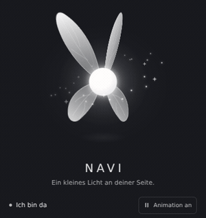

# NAVI — Copilot Companion

## NAVI direkt herunterladen

**[NAVI Copilot Companion v0.5.2 – VSIX direkt herunterladen](https://raw.githubusercontent.com/noahmagic77/navi-copilot-companion/main/downloads/navi-copilot-companion-0.5.2.vsix)**

Die Datei ist direkt installierbar – **kein ZIP-Entpacken erforderlich**. Öffne in **VS Code Desktop → Erweiterungen → … → Install from VSIX…** und wähle die heruntergeladene `navi-copilot-companion-0.5.2.vsix`.

[Installationsanleitung (Deutsch)](docs/INSTALLATION.md) · [Automatische Build-Ergebnisse](https://github.com/noahmagic77/navi-copilot-companion/actions/workflows/ci.yml?query=branch%3Amain)

Dies ist die **v0.5.2-Entwicklungsversion** mit dem neuen weißen Feenmodell, nicht die VS-Code-Marketplace-Version. [SHA-256-Prüfsumme](downloads/navi-copilot-companion-0.5.2.vsix.sha256).

TypeScript VS Code companion with an animated fairy guide, an offline deterministic prompt checker and privacy-first analytics.

**Status:** Public GitHub repository with an experimental v0.5.2 preview on `main`; no VS Code Marketplace release.

## Die Fee im Vordergrund (Windows x64)

NAVI v0.5.2 enthält einen kleinen nativen Windows-Helfer. Die weiße Fee kann vor Editor, Terminal und Seitenleisten des aktiven VS-Code-Fensters fliegen. Ihr transparentes Fenster lässt Mausklicks durch und übernimmt keinen Tastaturfokus. Beim Wechsel zu einem anderen Fenster oder beim Minimieren wird sie ausgeblendet und ihre Animationsuhr angehalten. Der Helfer ist im VSIX enthalten; ein separater Download oder eine zusätzliche Browser-Laufzeit sind nicht erforderlich.

**Öffnen:** `Strg + Umschalt + P` → **NAVI: Show Foreground Fairy / Vordergrund-Fee anzeigen**. **NAVI: Hide Foreground Fairy / Vordergrund-Fee ausblenden** beendet den Helfer. **NAVI: Open Companion / Ansicht öffnen** zeigt Einstellungen und die Vorschau der 110 Bewegungen. Die Erweiterung startet den aktivierten Helfer nach dem VS-Code-Start; `navi.overlay.enabled` steuert dies pro Benutzer. Auf anderen Plattformen bleibt die eingebettete NAVI-Ansicht verfügbar.

Im normalen Modus sind die Bildraten auf 30 FPS beim Fliegen, 15 FPS beim Schweben und 10 FPS beim Ausruhen begrenzt. Kurze Zustandswechsel verwenden zunächst die aktive Bildrate, damit das Absenken keine Sprünge verursacht. Der Sparmodus reduziert Bildrate und Glitzer zusätzlich. Ausgeblendet oder bei deaktivierter Animation werden keine Animationsbilder berechnet. Die Win32-Darstellung verwendet vorbereitete Grafikobjekte; die reine Bewegungsberechnung erzeugt pro Bild keine neuen Speicherobjekte.

[Overlay, Parameter und Messgrenzen](docs/OVERLAY.md)

## Die 110 Bewegungen und ihre Vorschau



Der aktuelle Entwicklungsstand bietet **110 auswählbare Bewegungen**: zwölf Grundzustände und zehn weitere Begrüßungen sowie 88 prozedurale Varianten aus Gleiten, Bögen, Hüpfen, Kreisen, Spuren, Spiralen, Leuchten und Gesten. Körper, Flügel, Licht und Glitzer bewegen sich nach einer gemeinsamen Uhr. Gedämpfte Übergänge erhalten Schwung und Flügelphase, statt Bewegungen bei jedem Wechsel neu zu starten. Die gemeinsame Animationsuhr verwendet explizite Bildratenlimits, unabhängig von der Bildwiederholrate des Bildschirms. Der oben verlinkte Download enthält diesen Stand.

NAVI reagiert auf Eingaben in ihrer Ansicht, variiert ihre Bewegungen im Leerlauf und ruht nach 90 Sekunden ohne Interaktion in der Webview. Unter **110 Bewegungen entdecken** kannst du jede nach Familie auswählen oder mit **Alle ansehen** eine vollständige Vorschau starten. Anschließend kehrt NAVI selbstständig zum natürlichen Verhalten zurück.

[Alle 110 Bewegungen im Video ansehen](docs/navi-12-motions.mp4) · [Bewegungen und Auslöser](docs/FAIRY-ANIMATIONS.md)

Der Schalter **Animation an/aus** speichert deine Einstellung in den VS-Code-Benutzereinstellungen. `navi.fairy.respectReducedMotion` entscheidet, ob NAVI die Systempräferenz für reduzierte Bewegung berücksichtigt; standardmäßig bleibt die Fee animiert. Ausgeblendete Ansichten pausieren einschließlich der Vorschau. Alle Grafik- und Animationsbestandteile sind enthalten, ohne externe Ressourcen.

**Vorschau öffnen:** `Strg + Umschalt + P` → **NAVI: Open Companion / Ansicht öffnen**, oder auf das NAVI-Symbol in der Activity Bar klicken. Die Companion-Ansicht lässt sich mit den VS-Code-Ansichtsfunktionen neben Copilot verschieben.

Die Animation wurde in Chromium mit derselben Webview und strikter CSP geprüft, einschließlich aller 110 Bewegungen in Folge, stetiger Übergänge, Eingabereaktionen, Ruhemodus, Pausieren, Wiederaufnahme, reduzierter Bewegung, schmaler Ansichten sowie heller und dunkler Darstellung. Der native Windows-Helfer wurde zusätzlich mit echten Fenstern auf einem Windows-Runner geprüft: Fokus, Fensterbewegung, Ausblenden, Minimieren/Wiederherstellen, Pipes und Shutdown. Ein vollständiger Live-Test im VS-Code-Extension-Host auf dem Zielrechner ist weiterhin separat erforderlich.

## Sprechblasen und Feenklänge

Die helle Sprechblase zeigt kurze Reaktionen und Auszüge aus NAVIs eigenen Chat-Antworten. Unter **Feenklänge** kannst du mit **Anhören** die zwölf eigenen Klänge testen. Automatische Klänge sind zunächst ausgeschaltet; aktiviere sie bei Bedarf und stelle die Lautstärke über null. [Sprechblasen](docs/SPEECH.md) · [Audio und Fehlerbehebung](docs/SOUND.md).

## Key features

- `@navi`, `/explain`, and `/summarize` using the model chosen by the user in VS Code Chat.
- NAVI Activity Bar view with an original white vector fairy, 110 selectable procedural animations with spring-smoothed transitions, orbiting sparkles, a motion toggle, accessible speech bubble and local prompt checker. The selected NAVI logo remains the bundled extension icon.
- Offline local prompt rules and a conservative *potential* topic-change suggestion. Tips are guidance, not verified token savings.
- Per-profile sanitized `JSONL` session journals, salted workspace grouping and a rebuildable **optional** SQLite index (`node:sqlite` when supported).
- Commands for deleting separate full-text NAVI history or sanitized analytics, export, index rebuilding and explicit local OTel metric-file import.
- Independent deterministic tests and GitHub CI on pull requests.

## Installation über GitHub

**[Installierbare VSIX v0.5.2](https://raw.githubusercontent.com/noahmagic77/navi-copilot-companion/main/downloads/navi-copilot-companion-0.5.2.vsix)** · [Ausführliche Anleitung](docs/INSTALLATION.md)

1. VSIX über den Link herunterladen (keine ZIP-Datei).
2. VS Code Desktop öffnen und **Erweiterungen → … → Install from VSIX…** auswählen.
3. Datei `navi-copilot-companion-0.5.2.vsix` auswählen und VS Code bei Bedarf neu laden.

Die Datei ist im Repository unter `downloads/` versioniert. Bei einer neuen Version muss dieser Download explizit erneuert werden; [GitHub Actions](https://github.com/noahmagic77/navi-copilot-companion/actions/workflows/ci.yml?query=branch%3Amain) stellt weiterhin temporäre Build-Artefakte bereit. Noch kein VS Code Marketplace Release.

## Installation for development

[Entwicklungsumgebung einrichten (Deutsch)](docs/DEVELOPMENT.md) — Installationen, erster Start, Vordergrund-Fee und VSIX-Build.

VS Code Desktop >= 1.100, Node.js >= 22 and npm.

```bash
npm install
npm run check
npm test
```

Press F5 to run the Extension Development Host. Run **NAVI: Show Foreground Fairy / Vordergrund-Fee anzeigen** on Windows x64 or **NAVI: Open Companion / Ansicht öffnen** for the embedded preview. Open NAVI in the Activity Bar, enter a prompt and select **Prompt analysieren**. You can also run **NAVI: Check Prompt** or address `@navi` in VS Code Chat.

## Privacy and storage

All local NAVI files are stored under `ExtensionContext.globalStorageUri`, separated by user environment/profile. NAVI has **no central backend**. New installations default to `navi.history.enabled=false` and `navi.analytics.enabled=false`; previous legacy chat data is untouched and can be deleted explicitly. Enabling full NAVI own-chat history saves prompt and response contents unencrypted locally, so opt in only if appropriate. Sanitized analytics contain only rule codes, session identifiers and counts, no source code and no full prompts. Exported files are user-controlled. The selected chat model may still send prompts to its provider; NAVI itself makes no extra LLM request for the local checker.

NAVI **does not** access GitHub Copilot's private conversations, intercept its prompt input or record its token usage automatically. Importing a JSONL metric file is an explicit user action, has format constraints, and reimporting the same file creates duplicate metrics; see [Integration limitations](docs/INTEGRATION.md).

## Source tree

- `src/core/` — independent TypeScript analysis rules and OTel metric parser
- `src/storage/sessionJournal.ts` — sanitized JSONL primary store and optional SQLite cache
- `src/ui/naviView.ts` — Webview lifecycle, local messages and motion preferences
- `src/ui/fairyMarkup.ts`, `src/ui/webviewContent.ts`, `media/fairy.*` — original white vector fairy, animation and Webview UI
- `media/fairy-motion.js` — shared motion catalogue, pose sampling and deterministic spring model
- `src/overlay/` — verified child-process lifecycle and VS Code overlay controls
- `native/overlay/` — native Go/Win32 renderer, window event hooks, bounded flight and tests
- `bin/win32-x64/` — tested Windows helper and SHA-256
- `media/logo.png` — selected extension icon
- `src/chat/participant.ts` — existing VS Code Chat Participant, with local analysis callback
- `src/storage/localHistoryStore.ts` — backwards-compatible, opt-in own-chat history
- `docs/` — architecture/ADR and integration notes
- `prototypes/v0.3.0/` — earlier reference-only JavaScript implementation on separate import branch (see PR #1)

## Scope and next milestones

NAVI currently provides a local prompt checker and a general `@navi` chat participant; it does not yet teach programming through a guided, hint-first workflow. The learning roadmap is to help users reason and try steps themselves before offering a complete solution, while keeping chat boundaries and model-provider use explicit. No age profile is needed. See [Roadmap](docs/roadmap.md), [Architecture](docs/architecture.md) and [Integration](docs/INTEGRATION.md).

The SQLite backend and full VS Code integration have not yet been validated in a live extension host. Native rendering, native window integration and local control pipes have passed their Windows-runner tests. Run live E2E tests before claiming support for every OS/remote mode. See [ADR 0002](docs/adr/0002-sanitized-session-storage.md).

Public GitHub repository for an experimental preview. The repository being public does not imply a VS Code Marketplace publication; consult LICENSE.md for the applicable licensing terms.
