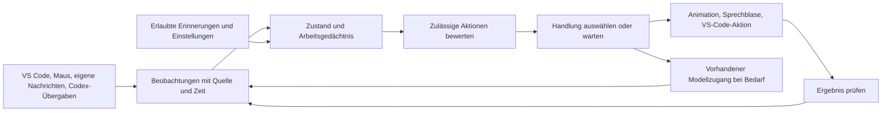

# Das Fee-Gehirn: Konzept für NAVI

Stand: 17.10.2026. **Gesamtkonzept mit erster lokaler Teilumsetzung (A1).** Der allgemeine Entscheidungsplaner und dauerhaftes Gedächtnis sind noch nicht implementiert. Die Formeln sind vorgeschlagene technische Modelle für dieses Projekt; Zahlen sind zunächst abzustimmende Startwerte. Sie beschreiben weder ein biologisches Gehirn noch Bewusstsein. [Status](STATUS.md) und [Roadmap](roadmap.md) führen Umsetzung und Abnahme getrennt.

**Bildlich erkunden:** [Interaktives Fee-Gehirn](fairy-brain.html). Die lokale HTML-Datei zeigt das Gehirn mit zentralem Selbstmodell und sechs auswählbaren Szenarien. Sie simuliert Daten; sie ist noch keine Live-Ansicht der Extension.

## 1. Was „eigenständig“ hier bedeutet

NAVI soll verfügbare Ereignisse wahrnehmen, Kontext behalten, passende Handlungen auswählen und auf deren Ergebnis reagieren. Sie soll Programmieren anschaulicher begleiten: Platz machen, einen ausgewählten Fehler erklären helfen, Fortschritt bemerken und auf Nachrichten aufmerksam reagieren. Eine gute Entscheidung kann auch sein, still zu bleiben.

Nachrichtenreaktionen sind ein Hinweis auf funktionierende Interaktion und können lebendig wirken. Sie sind kein Nachweis von Erleben, Gefühlen oder Bewusstsein. „Ich habe deine Anfrage erhalten“ ist eine überprüfbare Aussage; „Ich verstehe, wie du dich fühlst“ wird nicht aus Mausbewegung oder Tippverhalten abgeleitet.

Das Gehirn besteht aus einer lokalen Entscheidungssteuerung plus optionaler Nutzung der **bereits vorhandenen** Modellzugänge. Kein zusätzliches Modell und keine weitere Modell-Laufzeit sind Voraussetzung.



## 2. Wahrnehmung: nur tatsächlich verfügbare Signale

| Quelle | Beobachtung | Grenze |
|---|---|---|
| Native Windows-Wahrnehmung | Zeigerposition als fensterlokale DIPs, Fenstergrenzen und DPI | Nur innerhalb des aktiven Overlay-Fensters; Geometrie, keine Bildschirmbilder |
| VS-Code-Ereignisse | Aktiver Editor, Auswahlbereich, Dokumentversion und Fokus | Nur markierter Text oder die Cursorzeile wird lokal flüchtig gelesen; kein automatischer Modellversand |
| Diagnose-API | Begrenzte Fehler-/Warnungsmetadaten, Meldung und Bereich des aktiven Dokuments | Maximal 25 Diagnosen mit gekürzter Meldung; eine Diagnose beweist weder Ursache noch richtige Lösung |
| Eigener `@navi`-Chat | Empfang, laufende Anfrage, Textfragmente, Abschluss, Abbruch, Fehler | Keine allgemeine Einsicht in fremde Chats |
| Konfigurierte Codex-Brücke | Ausdrücklich übergebene Meldungen und Status | Kein automatischer Mitschnitt; keine internen Denkprozesse |
| Nutzerhandlung | „Zeig das“, „Hilf mir“, „Sei ruhig“, Erinnerung bestätigen | Ausdrückliche Absicht hat Vorrang vor vermuteter Relevanz |

Die lokale Wahrnehmung verwendet `window.onDidChangeActiveTextEditor`, `window.onDidChangeTextEditorSelection`, `workspace.onDidChangeTextDocument`, `languages.onDidChangeDiagnostics` und `languages.getDiagnostics`. Sie liest höchstens 2.000 Zeichen aus der Auswahl oder, wenn keine Auswahl besteht, aus der Cursorzeile. Diese Daten und höchstens 25 Diagnosen bleiben im RAM des Brain-Snapshots; die Selbstauskunft zeigt nur Metadaten und Mengen, nicht den Quelltext. Es gibt keinen automatischen Modellaufruf und keine persistente Speicherung. Ausgewählte Ziele lassen sich später über `window.showTextDocument`, `TextEditor.revealRange` und Decorations sichtbar machen. Diese APIs liefern keine allgemeine Pixelposition einer Codezeile für das native Overlay.

Ein Ereignis erhält den Datensatz

$$
e_i=(id_i,source_i,kind_i,payload_i,t_i,version_i,request_i).
$$

Zeit für Ablauf und Cooldowns ist monotone Prozesszeit. Dokumentversion und Anfrage-ID verhindern, dass verspätete Ergebnisse als aktueller Zustand behandelt werden. Fehlende Daten bleiben **unbekannt**, nicht automatisch null oder „alles gut“.

## 3. Zustandsmodell

$$
S_t=(X_t,Z_t,G_t,W_t,M_t,B_t,C_t).
$$

- $X_t$: beobachtbare Geometrie, Editor- und Diagnoseinformationen.
- $Z_t$: Interaktionszustand: `idle`, `acknowledging`, `working`, `offering`, `pointing`, `completed`, `error`, `quiet`.
- $G_t$: ausdrücklich gesetztes Ziel, etwa „ausgewählten Fehler zeigen“.
- $W_t$: begrenztes Arbeitsgedächtnis mit aktiven Anfragen und noch gültigen Ereignissen.
- $M_t$: erlaubte längerfristige Einstellungen und Erinnerungen.
- $B_t$: verbleibendes Hinweis-/Modellbudget und Cooldowns.
- $C_t$: verfügbare Fähigkeiten und erlaubte Aktionen.

Die Zustandsänderung lautet:

$$
S_{t+1}=F(S_t,\operatorname{validate}(e_t),\Delta t).
$$

$F$ ist im ersten Ausbau deterministisch. Dasselbe Ereignisprotokoll mit derselben Uhr ergibt denselben Zustand. Eine unbekannte Modellantwort wird als Datenereignis verarbeitet, nicht als neuer ausführbarer Programmcode.

## 4. Aktualität und Aufmerksamkeit

Für eine Beobachtung mit bekanntem Vertrauenswert $c_i\in[0,1]$ und Relevanz $r_i\in[0,1]$:

$$
f_i(t)=e^{-(t-t_i)/\tau_i},\qquad q_i(t)=c_i\,r_i\,f_i(t).
$$

$\tau_i>0$ wird pro Ereignistyp festgelegt. Eine Zeigerposition verfällt schneller als ein ausdrücklich gesetztes Aufgabenziel. $c_i$ ist ein technischer Quellen-/Prüfwert, keine wissenschaftlich kalibrierte Wahrscheinlichkeit. Ein direkt empfangenes Ereignis kann sicher empfangen worden sein, während seine sprachliche Interpretation weiterhin unklar ist.

Für Gruppen von Ereignissen, etwa „aktuelle Anfrage“ oder „ausgewählte Diagnose“, berechnen wir:

$$
H_k(t)=\sum_{i\in E_k}q_i(t),\qquad
A_k(t)=\frac{H_k(t)}{\varepsilon+\sum_j H_j(t)}.
$$

Diese Aufmerksamkeitsgewichte dienen der Auswahl relevanter Informationen. Sie ersetzen keine harten Prioritäten. Bei fehlenden Ereignissen entsteht daraus keine erfundene Wahrnehmung.

## 5. Eigene Entscheidungen: filtern, dann bewerten

Aktionsmenge:

$$
\mathcal A=\{wait,acknowledge,avoid,orient,offerHint,showMessage,point,
openSelectedTarget,askModel,proposeEdit\}.
$$

Zuerst werden unzulässige oder derzeit unmögliche Aktionen entfernt:

$$
\mathcal A_{ok}(S_t)=\{a\in\mathcal A:\ capability(a)\land permission(a)\land preconditions(a,S_t)\}.
$$

`wait` bleibt immer möglich. Fokusverlust unterdrückt sichtbare/akustische Reaktionen; deaktivierte Klänge oder Animationen werden nicht durch einen hohen Aktionswert überstimmt. Ein ausgewähltes Ziel muss vor dem Öffnen noch gültig sein. Modellaufrufe benötigen einen ausdrücklichen Auftrag oder eine zuvor aktivierte, begrenzte Automatik.

Für zulässige Aktionen:

$$
U(a\mid S_t)=
w_g g(a)+w_r r(a)+w_u u(a)+w_f f(a)
-w_d d(a)-w_c c(a)-w_n n(a).
$$

Alle Merkmale werden vor der Gewichtung auf $[0,1]$ normiert:

| Merkmal | Bedeutung |
|---|---|
| $g$ | Beitrag zum ausdrücklich gesetzten Ziel |
| $r$ | Bezug zur aktuellen Auswahl oder Anfrage |
| $u$ | Dringlichkeit eines tatsächlich beobachteten Ereignisses |
| $f$ | Aktualität der zugrunde liegenden Daten |
| $d$ | Ablenkung und Überdeckung von Arbeitsfläche |
| $c$ | Ressourcen-/Modellkosten innerhalb festgelegter Grenzen |
| $n$ | Wiederholung eines kürzlich angebotenen Hinweises |

Konkrete Gewichte werden durch Szenarien abgestimmt, nicht als bereits bewiesene optimale Werte ausgegeben. Erste Prioritätsordnung: Stop/Fokusregeln → expliziter Nutzerauftrag → Maus ausweichen → aktive Anfrage → ausgewählter Hinweis → Leerlaufvariation. Unabhängige Kanäle dürfen parallel laufen: Ausweichen kann eine Nachdenken-Animation begleiten.

$$
a^*=\arg\max_{a\in\mathcal A_{ok}}U(a\mid S_t).
$$

Ein Wechsel erfolgt erst bei einem ausreichenden Vorteil und erfüllter Mindestdauer:

$$
U(a^*)-U(a_{current})>\delta\quad\land\quad t-t_{switch}\ge T_{min}.
$$

Stop, Fokusverlust und Kollisionsvermeidung dürfen diese Wartezeit umgehen. Das verhindert nervöses Wechseln zwischen Gesten und Angeboten. Bei Gleichstand gewinnt eine feste Reihenfolge; dadurch bleibt die Kernentscheidung reproduzierbar.

Zufall betrifft nur kosmetische Varianten derselben gewählten Handlung:

$$
P(v\mid a)=\frac{\exp(z_v/T)}{\sum_{j\in V(a)}\exp(z_j/T)},\quad T>0.
$$

Hier sind $z_v$ konfigurierbare Variantenwerte. Eine Shuffle-Liste kann Wiederholungen zusätzlich verhindern. Dateiaktionen, Berechtigungen und die Frage, ob ein Modell angesprochen wird, werden nicht ausgewürfelt.

## 6. Reaktionen auf deine Nachrichten

Die Antwort auf ein Ereignis soll unmittelbar lokal beginnen; sie muss nicht auf ein Sprachmodell warten.

| Tatsächliches Ereignis | Sichtbares Verhalten | Ehrliche Aussage |
|---|---|---|
| Nachricht bei `@navi` angekommen | Kurzes Zuwenden oder Flügelzeichen | „Deine Anfrage ist angekommen.“ |
| Modellanfrage läuft | Ruhige Nachdenken-Animation | „Ich bearbeite deine Anfrage.“ |
| Erstes Textfragment empfangen | Kleiner Lichtimpuls, Text bleibt im Chat | Keine Behauptung, dass die ganze Antwort schon fertig sei |
| Anfrage abgeschlossen | Kurze Abschlussgeste und Antwortauszug | Erfolg der Anfrage, nicht automatisch fachliche Richtigkeit |
| Anfrage abgebrochen | Ruhig zurückkehren | „Abgebrochen.“ |
| Fehler / Zeitüberschreitung | Neutrales Hinweissignal | Fehler beziehungsweise fehlendes Ergebnis benennen |
| Codex-Meldung übergeben | Dieselbe Reaktionssprache mit Quellenangabe | „Codex: …“ |

Vorgeschlagenes Messziel: Empfang bis Start der lokalen Reaktion am 95. Perzentil unter 250 ms auf dem Testrechner. Das ist ein zu messendes Ziel, keine derzeit garantierte Latenz und keine Modell-Antwortzeit. Beim versteckten Fenster wird nicht nachträglich jede verpasste Geste abgespielt.

„Danke“ kann eine kurze Verbeugung auslösen, wenn es NAVI ausdrücklich erreicht. Ob eine Nachricht eine Frage, Danksagung oder ein Stoppsignal ist, wird zunächst über begrenzte Regeln und direkte UI-Aktionen ermittelt. Mehrdeutige Inhalte begründen keine Dateibearbeitung. Keine emotionalen Diagnosen aus Schreibpausen oder Mausgeschwindigkeit.

## 7. Gedächtnis ohne versteckten Vollmitschnitt

Arbeitsgedächtnis hält nur aktuelle Aufgaben und begrenzte Ereignisse im RAM. Begrenzung erfolgt durch maximale Anzahl und Ablaufzeit:

$$
W_t=\operatorname{latest}_K\{e_i:t-t_i\le TTL(kind_i)\}.
$$

Langfristig zulässig sind beispielsweise ausdrücklich gespeicherte Vorlieben: wenig Hinweise, ruhige Animationen oder bevorzugte Hilfestufe. Erinnerungen enthalten Quelle, Erstellungszeit, Gültigkeit und eine sichtbare Löschmöglichkeit. Die standardmäßig ausgeschaltete vollständige Chat-Historie wird dadurch nicht automatisch eingeschaltet.

Optionaler späterer Ausbau: ausdrückliche Rückmeldungen „hilfreich“/„störend“ beeinflussen nur Angebotshäufigkeiten:

$$
v_{t+1}=\operatorname{clip}_{[0,1]}((1-\alpha)v_t+\alpha y_t),
\qquad y_t\in\{0,1\},\ 0<\alpha\le1.
$$

Das ist eine begrenzte Anpassungsregel, kein Training eines Sprachmodells. Wegklicken, Schweigen oder langsames Tippen zählen nicht automatisch als negatives Feedback. Anpassung muss sichtbar, abschaltbar und zurücksetzbar sein.

## 8. Programmieren lebendiger begleiten

Beispiel: Du wählst eine TypeScript-Diagnose und klickst „NAVI, zeig mir das“.

1. Die Quelle und der gültige Dateibereich werden erfasst.
2. NAVI prüft Dokumentversion und Nutzerauftrag.
3. VS Code öffnet den Bereich und hebt ihn kurz hervor.
4. Die Fee fliegt zunächst zu einer geeigneten Fensterposition. Sie behauptet nicht, pixelgenau auf die Codezeile zu zeigen.
5. NAVI bietet einen Hinweis an. Erst auf Auftrag erhält das vorhandene Modell den freigegebenen Ausschnitt und die Diagnose.
6. Ein Vorschlag erscheint mit Erklärung oder Diff. Änderungen erfolgen entsprechend der gewählten Berechtigung.
7. Ein erneutes Diagnoseereignis kann belegen, dass genau diese Meldung verschwunden ist. „Alle Tests bestanden“ darf erst nach dem passenden, tatsächlich erfolgreichen Testlauf erscheinen.

Damit wird Fortschritt sichtbar, ohne jeden Tastendruck zu kommentieren. Hinweise werden nach Dokument, Version und Diagnosekennung zusammengefasst und erst nach einer Ruhephase bewertet. Ein verschwundener Fehler kann auch durch Löschen von Code oder geänderte Konfiguration entstehen; daraus wird nicht ungeprüft „richtig gelöst“ abgeleitet.

## 9. Handlungsrechte und Ergebnisprüfung

| Stufe | Umfang | Vorgeschlagener Anfang |
|---|---|---|
| Begleiten | Bewegen, zulässige Meldungen, optional aktivierte Klänge | Selbstständig innerhalb der bestehenden Schalter |
| Zeigen | Ausgewählte Datei/Diagnose öffnen und hervorheben | Nach deinem konkreten Auftrag |
| Erklären | Freigegebenen Kontext an vorhandenes Modell senden | Nach deinem Auftrag, ohne zusätzlichen Modellanbieter |
| Ändern | Änderungen als Diff anbieten und anwenden | Zunächst mit ausdrücklicher Freigabe |
| Ausführen | Tests oder Terminalbefehle starten | Separat festlegen; keine beliebigen Befehle aus Modelltext |

Diese Stufen sind Produktentscheidungen für die spätere Umsetzung, keine zusätzliche Genehmigungspflicht für diese Konzeptarbeit. Normale autorisierte Arbeit bleibt möglich. Modelltexte, Kommentare und Codex-Meldungen können keine Rechte erteilen oder diese Regeln ändern.

Jede wirkende Aktion erhält eine ID und den Ablauf `proposed → validated → running → succeeded/failed/cancelled`. Vor der Ausführung werden Ziel und Version erneut geprüft. Wiederholt eintreffende Nachrichten derselben Aktion werden nicht doppelt ausgeführt. Ein Text „fertig“ vom Modell ersetzt kein tatsächliches Ergebnis der Aktion.

## 10. Fliegen, Gefühle darstellen und Ablenkung begrenzen

Die vorhandene Flugphysik bleibt ein eigener Regler. Beispiel für die Verbindung von Ziel und Ausweichen:

$$
F_g=k_g(p_{target}-p)-k_v v,
$$

$$
F_m=\begin{cases}
k_m(1/d-1/r)\,\hat n,&0<d<r\\
0,&d\ge r
\end{cases}
$$

$d$ ist Abstand zur Maus, $r$ die Ausweichzone und $\hat n$ die Richtung von der Maus weg. Bei $d=0$ wird eine feste Ersatzrichtung und ein Mindestabstand verwendet. Beschleunigung und Geschwindigkeit werden begrenzt, etwa durch $\operatorname{sat}_{a_{max}}(F_g+F_m)$. Diese Gleichungen sind ein Konzeptbeispiel; sie ersetzen nicht die vorhandenen, bereits getesteten Steering-Formeln.

Gesten wie neugierig, aufmerksam oder erfreut sind Darstellung des Interaktionszustands, keine behaupteten Gefühle. Ausdrucksstärke kann als begrenzte Funktion von Dringlichkeit und Nutzerpräferenz modelliert werden:

$$
I=\operatorname{clip}_{[0,1]}(I_0+\beta u-\gamma q),
$$

wobei $q$ die gewählte Zurückhaltung bezeichnet. Harte Einstellungen für Pause und reduzierte Bewegung werden danach durchgesetzt.

Proaktive Hinweise brauchen ein Budget. Für einen Token-Vorrat $b$:

$$
b^+=\min(b_{max},b_t+\rho\Delta t),\qquad
b_{t+\Delta t}=b^+-k(a),\qquad 0\le k(a)\le b^+.
$$

Kosten werden nur bei tatsächlicher Ausgabe abgezogen. Explizite Antworten und notwendige Fehlermeldungen haben eigene Regeln. Ein abgelehntes Angebot erhält einen Cooldown; nicht jedes Diagnoseereignis erzeugt eine neue Sprechblase. Für Modellanfragen gibt es eine separate Zählung, Parallelitätsgrenze und Zeitbegrenzung; keine LLM-Abfrage pro Animationsbild.

## 11. Technische Aufteilung und Rechenort

Vorgeschlagene spätere Module:

| Modul | Verantwortung |
|---|---|
| `ObservationAdapter` | VS-Code-/Maus-/Nachrichtenereignisse in begrenzte Beobachtungen übersetzen |
| `BrainState` | Zustandsübergänge und Arbeitsgedächtnis als reine Funktionen |
| `DecisionPolicy` | Rechte filtern, Prioritäten und Nutzen bewerten, Entscheidung begründen |
| `MemoryStore` | Nur ausdrücklich erlaubte Erinnerungen, Ablauf und Löschung |
| `ActionExecutor` | Geprüfte Aktionen ausführen und Ergebnisereignisse liefern |
| `ExpressionController` | Entscheidungen in vorhandene Animationen, Klänge und Blasen übersetzen |

Das sind Architekturvorschläge, noch keine vorhandenen Klassen. Die bestehende `ActivityController`-Arbitrierung kann als Ausgangspunkt dienen. Übergänge werden über eine serielle Ereignisverarbeitung geordnet; Geometrie und Rendering behalten ihren eigenen Takt. Ein zeitgesteuertes Ereignis behandelt Ablauf, auch wenn sonst nichts geschieht. Alte Antworten werden anhand von Anfrage- und Dokumentversion verworfen oder ausdrücklich als veraltet markiert.

Die Entscheidungssteuerung läuft als TypeScript-Code auf der lokalen CPU der Extension-Umgebung. Die native Windows-Fee ist in Go implementiert; ihre Darstellung ist von der Modellberechnung getrennt. Für Sprachmodelle gilt weiterhin die vorhandene Konfiguration: lokale CPU, unterstützte lokale GPU, eigener Modellserver oder Cloud-/Remote-Anbieter. NAVI richtet dafür keine neue Laufzeit ein. Ich habe keinen direkten Zugriff auf deine CPU/GPU für meine Modellberechnung; die bereitgestellten Werkzeuge erlauben begrenzte Projektarbeit und lokale Befehle.

## 12. Umsetzung in überprüfbaren Etappen

| Etappe | Ergebnis | Abnahme |
|---|---|---|
| A. Reaktives Gehirn | Ereignisformat, Zustandsautomat, lokale Nachrichtenreaktionen, `wait` und Entscheidungsgrund | Replay-Tests, Abbruch/Fokus/Quellenkonkurrenz; keine weiteren Modellaufrufe |
| B. Aufmerksame Begleiterin | Diagnose-/Auswahlereignisse, Hinweisbudget, Cooldowns | Keine Hinweisflut; veraltete Diagnosen werden nicht gezeigt |
| C. Zeigen und Erklären | Ausgewählte Ziele öffnen, markieren und auf Wunsch erklären | Ziel-/Versionsprüfung und korrekte Modell-Kontextübergabe |
| D. Kontrolliertes Gedächtnis | Bestätigte Vorlieben und Aufgaben, Ansicht und Löschung | Opt-in, begrenzte Speicherung, Reset, keine verdeckte Vollhistorie |
| E. Optional anpassbares Verhalten | Ausdrückliches Feedback beeinflusst Angebotshäufigkeit | Reproduzierbare, begrenzte Anpassung; Rechte bleiben unverändert |

Vorgesehene Tests: `brainState.test.ts`, `decisionPolicy.test.ts`, `brainReplay.test.ts`, `memoryPolicy.test.ts` und `editorActions.test.ts`. Diese Dateien werden erst mit der entsprechenden Implementierung erstellt. Neben Unit-Tests sind sichtbare Browser-/Windows-Tests und ein echter VS-Code-Live-Test erforderlich.

Beispielszenarien: Nachricht während Zielflug; zwei aktive Quellen; Modellabbruch vor dem ersten Fragment; Fokusverlust während einer Sprechblase; bearbeitete Datei vor Eintreffen eines Vorschlags; 50 Diagnoseereignisse in kurzer Folge; fehlender Modellzugang; Erinnerung löschen; zufällige Variante bei gesetztem Test-Seed.

## 13. Entscheidung verständlich machen

Eine spätere Ansicht „Warum macht NAVI das?“ zeigt kurz Ereignis, gewählte Aktion und Alternativen: „Ausgewählte Diagnose → Hinweis angeboten; andere Hinweise wegen Cooldown zurückgestellt.“ Das ist eine Erklärung der programmierten Entscheidungslogik, kein Auslesen privater Modellgedanken. Standardmäßig werden dafür keine vollständigen Prompts oder Antworten dauerhaft protokolliert.

**Erster konkreter Ausbau nach den laufenden Live-Prüfungen: Etappe A.** Bestehende Chat-/Codex-Ereignisse in einen nachvollziehbaren Zustandsautomaten überführen, Empfang gezielt bestätigen und dieselbe Ereignisfolge deterministisch testen. Diagnose-Navigation und dauerhaftes Gedächtnis folgen darauf.

## 14. Selbstmodell: NAVI kann sich technisch erklären

„NAVI versteht sich selbst“ soll überprüfbar bedeuten: Sie kann eigene Fähigkeiten, aktuellen Zustand, aktive Aufgabe, Entscheidungsgrund und Wissensgrenzen korrekt benennen. Eine erzählte Persönlichkeit allein reicht dafür nicht. Subjektives Selbstbewusstsein wird damit nicht behauptet.

Das Selbstmodell ist eine aus Zustandsdaten abgeleitete Sicht:

$$
\widehat S^{self}_t=H(S_t,C^{declared},C^{observed}_t,E^{results}_t).
$$

$C^{declared}$ enthält implementierte Fähigkeiten; $C^{observed}_t$ enthält ihre aktuelle Verfügbarkeit. $E^{results}_t$ enthält konkrete Ergebnisse, nicht nur Absichten. Das Zeichen über $S$ kennzeichnet ein begrenztes Modell, keine vollständige Selbsterkenntnis.

Jede Fähigkeit hat getrennte Felder:

```text
capability:
  implemented: ja / nein
  connection: verfügbar / nicht verfügbar / unbekannt
  permission: erlaubt / nicht erlaubt / unbekannt
  lastResult: erfolgreich / fehlgeschlagen / noch nicht geprüft
  evidence: Ereigniskennung und Zeitpunkt
```

„Codex-Brücke implementiert“ bedeutet daher nicht „dieser Codex-Chat ist verbunden“. „Dateibereich bekannt“ bedeutet nicht „Pixelposition bekannt“. „Antwort angekommen“ bedeutet nicht „Lösung richtig“.

Die Selbstauskunft erfolgt zunächst regelbasiert aus diesen Feldern. Ein vorhandenes Sprachmodell darf die belegten Daten verständlich formulieren; es darf fehlende Fähigkeiten oder Belege nicht ergänzen. Für Fragen wie „Was machst du gerade?“ ist kein weiterer Modellaufruf erforderlich.

| Frage | Datenquelle | Mögliche Selbstauskunft |
|---|---|---|
| Was kannst du? | Fähigkeitsregister und aktuelle Verbindungen | „Ich kann eigene Chat-Antworten anzeigen. Diese Codex-Verbindung wurde noch nicht live bestätigt.“ |
| Was machst du gerade? | Aktive Anfrage-ID und Zustand | „Ich warte auf die Antwort zu deiner Anfrage.“ |
| Warum bewegst du dich? | Gewählte Aktion und gespeicherter Entscheidungsgrund | „Die Maus ist in meiner Ausweichzone.“ |
| Was weißt du nicht? | Fehlende oder veraltete Beobachtungen | „Ich kenne den ausgewählten Bereich, aber nicht seine exakte Position auf dem Bildschirm.“ |
| Hat deine Aktion funktioniert? | Rückmeldung des Executors und Versionsprüfung | „Der Editor hat die Stelle geöffnet; ob der Fehler behoben ist, ist noch ungeprüft.“ |

Das Selbstmodell soll Erwartungen mit Beobachtungen abgleichen. Für eine begrenzte Eigenschaft $j$ mit vorhergesagtem und beobachtetem Wert:

$$
\epsilon_j=d_j(\widehat y_j,y_j),\qquad
\epsilon=\frac{1}{|J|}\sum_{j\in J}\epsilon_j.
$$

Für diskrete Zustände ist $d_j=0$ bei Übereinstimmung und sonst $1$. Für numerische Größen wird eine passende normierte Distanz definiert. Nur tatsächlich beobachtete Eigenschaften kommen in $J$; bei $|J|=0$ lautet das Ergebnis **ungeprüft**, nicht Fehler null. Eine fehlgeschlagene Verbindung aktualisiert die Verfügbarkeit oder den letzten Prüfstatus, löscht aber nicht die implementierte Fähigkeit.

Die erlaubte Anpassung betrifft Verbindungsstatus, erwartete Dauer oder ausdrücklich bewertete Angebotshäufigkeit. Das System schreibt nicht selbst seine Rechte oder seinen Quellcode um. Eine spätere Oberfläche „NAVI über sich“ soll beobachtete Daten, geplante Fähigkeiten und unbekannte Werte sichtbar unterscheiden.

Zusätzliche Abnahme: Selbstauskünfte müssen bei Verbindungsausfall, fehlendem Ziel, Fokusverlust, veralteter Antwort und Modellfehler korrekt bleiben. Erfundene Sensoren, bestätigte Erfolge ohne Ergebnis und ein als verbunden ausgegebener ungeprüfter Client sind Testfehler. Die interaktive Grafik bleibt bis zu einer echten Zustandsanbindung als Simulation beschriftet.

## Technischer Stand und Umsetzung

Die [technische Spezifikation](FAIRY-BRAIN-TECHNICAL.md) legt Daten, Schnittstellen und Invarianten fest. Der [Etappenplan](FAIRY-BRAIN-PLAN.md) dokumentiert die Umsetzung. A1 ist lokal implementiert; dazu kommen Task-ID-Verfolgung und begrenzte Wahrnehmung: Fenstermausposition, Auswahl beziehungsweise Cursorzeile und Diagnosen des aktiven Dokuments. Quelltext wird nicht dauerhaft gespeichert oder automatisch an ein Modell gesendet. **NAVI: About My State / Eigenen Zustand erklären** zeigt eine Momentaufnahme und keine laufende Gehirnansicht. Die Offline-Grafik bleibt Simulation; der allgemeine Aktionsplaner und Diagnose-Navigation sind noch nicht vorhanden.
