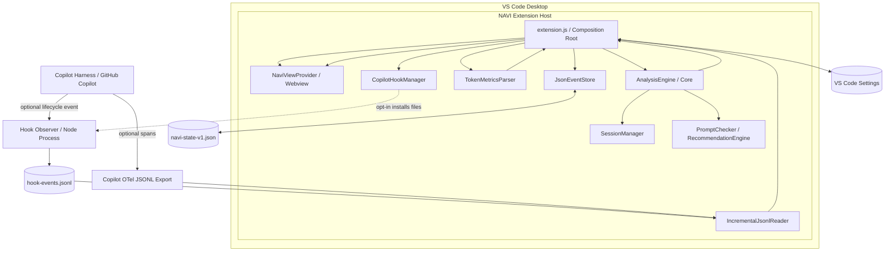
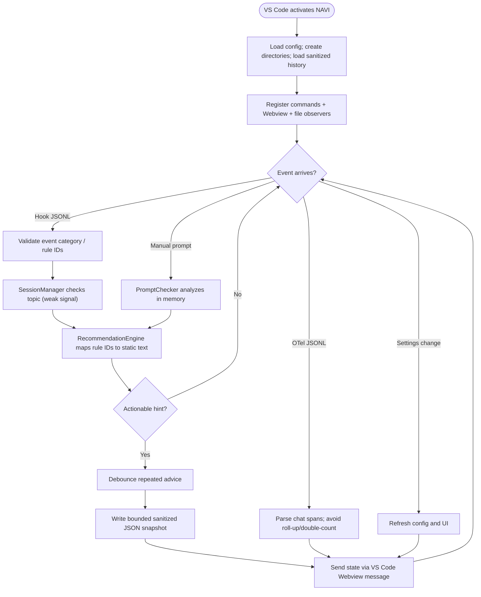
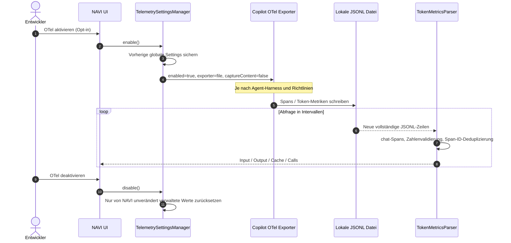
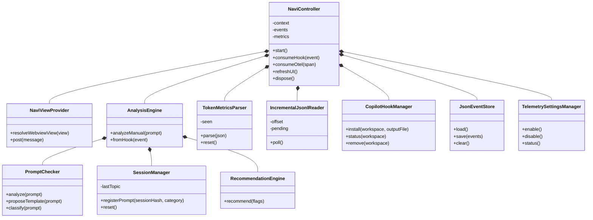
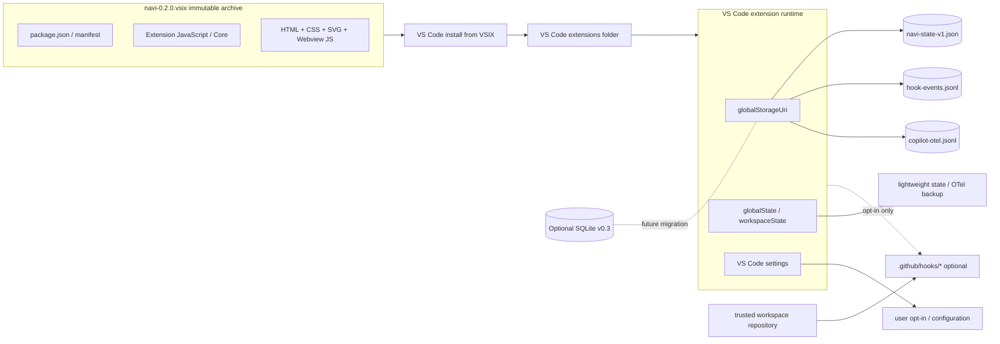
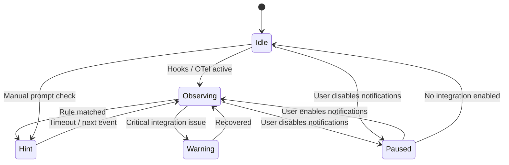

> **Archivierter Stand v0.2.** Speicherimplementierung in v0.3 siehe [storage-architecture-v03.md](storage-architecture-v03.md).

# NAVI — Technische Systemarchitektur

**Status:** Architekturstand v0.2.0 · **Datum:** 16.10.2026 · **Reifegrad:** implementierter MVP + dokumentierte Erweiterungsarchitektur

## 1. Ziel, Abgrenzung und Architekturrichtlinien

NAVI ist ein optionaler lokaler Begleiter für GitHub Copilot in Visual Studio Code. Das Produkt verbessert die Qualität und den Kontextbezug von Prompts durch Hinweise, statt den Entwickler-Workflow zu dominieren. Es ist kein zweiter Copilot und kein Chat-Proxy.

**Architekturprinzipien:**

- **Local first:** Die Analyseengine sendet keine zusätzlichen Requests an LLM-APIs.
- **Read-only by default:** Kein automatisches Abfangen, Blockieren oder Umschreiben des originalen Copilot-Chattextes.
- **Opt-in:** Hook-Ausführung und OTel-Export nur nach bewusster Aktivierung.
- **Privacy by design:** Prompttext nur im flüchtigen Prozessspeicher, persistent ausschließlich abgeleitete Regeln und Metadaten.
- **Fail open:** Fehler des Hook-Observers dürfen Copilot nicht blockieren.
- **Dependency inversion:** Analyselogik, Integration und UI sind trennbar und testbar.
- **Trust boundary:** Die `.vsix` ist Software; `.github/hooks/*.cjs` sind ebenfalls ausführbarer Code und unterliegen einem separaten Vertrauensmodell.
- **Truthful metrics:** Tokenzahlen aus unterstützten `chat`-Spans; keine fiktiven Kosteneinsparungen.

## 2. Layer- und Komponentenarchitektur

Die Implementierung nutzt CommonJS-JavaScript in fachlich getrennten Modulen und zusätzliche TypeScript-Deklarationen in `src/types/contracts.d.ts`. Diese Entscheidung erhält die Offline-Baufähigkeit ohne Laufzeit-Dependencies. Für v0.3 kann ein offizieller TypeScript-Build ergänzt werden.



| Layer | Hauptmodule | Verantwortung | Fremd-SDK-Abhängigkeit |
|---|---|---|---|
| UI | `NaviViewProvider.cjs`, `media/*` | CSP-geschützte Webview, Fee, Sprechblase, Prompt-Check, Kommandos | `vscode` |
| Application | `extension.js` | Lebenszyklus, Commands, Debounce, Datenfluss, DI | `vscode`, Node FS |
| Core | `AnalysisEngine`, `PromptChecker`, `SessionManager`, `RecommendationEngine`, `TokenMetricsParser` | Regeln, Heuristik, Topic-Wechsel, Tokenaggregation | keine |
| Integrations | `CopilotHookManager`, `IncrementalJsonlReader`, `TelemetrySettingsManager`, `observer.cjs` | Copilot-Schnittstellen, JSONL, OTel-Settings, Opt-in | GitHub Copilot und Dateisystem |
| Persistence | `JsonEventStore` | Begrenzte und atomare lokale JSON-Snapshots | Node FS |
| Contracts | `src/types/contracts.d.ts`, `docs/schema/*` | Ereignis-/Datenvertragsbeschreibung | keine |

**Unterschied implementiert vs. Zielarchitektur:** Die genannten JavaScript-Klassen und JSON-Speicher existieren in v0.2. SQLite, echte Multi-Root-Sitzungszuordnung, Benachrichtigungsprioritäten und ein erweiterter Rules-Editor sind geplante Komponenten.

## 3. Programmfluss



**Datenflussregeln:** Die UI darf keine direkten Node-FS-Zugriffe ausführen. Der Extension Host verifiziert alle Webview-Nachrichten anhand eines expliziten Command-Allowlists. Der Hook-Prozess schreibt nur ein minimales JSON-Objekt pro Ereignis; er schreibt niemals den Prompttext. Der OTel-Reader akzeptiert nur abgeschlossene JSONL-Zeilen und die Core-Engine zählt ausschließlich `chat`-Spans. `invoke_agent`-Summen werden nicht zusätzlich addiert.

## 4. Sequenz: Copilot-Prompt → NAVI-Hinweis

```mermaid
sequenceDiagram
    autonumber
    actor U as Entwickler
    participant C as VS Code Copilot Harness
    participant H as Hook Observer (Node)
    participant L as Local JSONL
    participant R as NAVI Reader
    participant A as AnalysisEngine
    participant S as JsonEventStore
    participant V as NAVI Webview
    U->>C: Copilot-Prompt absenden
    opt Hooks für unterstützten Harness aktiviert
      C->>H: userPromptSubmitted (temporärer Prompt)
      Note over H: Prompt nur im Prozessspeicher
      H->>H: Lokale Regeln; Session-ID pseudonymisieren
      H->>L: {kind, sessionHash, category, flags, words}
      H-->>C: {} (nicht blockieren / verändern)
      R->>L: Neue JSONL-Daten lesen
      L-->>R: Sanitisiertes Event
      R->>A: fromHook(event)
      A->>A: Topics + Regeln + Cooldown
      alt Relevanter neuer Hinweis
        A-->>S: Empfehlung persistieren (ohne Prompt)
        A-->>V: State + Sprechblase
        V-->>U: Dezenter NAVI-Hinweis
      else Kein relevanter Hinweis
        A-->>V: Optional Status aktualisieren
      end
    end
```

Der Copilot-Hook feuert **beim Absenden**, nicht bei jedem getippten Zeichen. Daraus folgt, dass automatische Echtzeit-Hinweise im originalen Eingabefeld nicht möglich sind. Der **manuelle NAVI Prompt Check** prüft Texte vor dem Absenden, allerdings ausschließlich solche, die der Anwender im NAVI-Fenster eingibt. Das Hook-API ist je nach Harness verschieden: Copilot-SDK nutzt `userPromptSubmitted`, der lokale VS-Code-Harness `UserPromptSubmit`.

## 5. Sequenz: OTel → Token-Metriken



**Metriksemantik:** Angezeigte Input-/Output-Tokenzahlen umfassen nur `chat`-Spans, die seit Aktivierung des Readers neu in seiner beobachteten Datei eingetroffen sind. Cache-Read-Tokens sind Teil der Input-Tokens und werden nicht erneut aufaddiert. Wo Span-IDs vorliegen, wird innerhalb des laufenden Readers dedupliziert. Nach einem Neustart des VS-Code-Hosts beginnen die Zähler wieder bei null; die JSONL-Datei kann bereits historische Daten enthalten. Unter nicht unterstützten Harnesses bleibt die Anzeige leer. Eine Aussage über eingesparte Tokens oder Euro ist aus diesen Daten allein **nicht zulässig**.

## 6. Klassendiagramm



**Separation of concerns:** `AnalysisEngine` kennt VS Code nicht. `SessionManager` kennt nur pseudonyme Sitzungskennzeichen und klassifizierte Themen. `NaviViewProvider` kennt nur zulässige Befehle und eine schmale Controller-Schnittstelle. `JsonEventStore` erhält bereits sanitisierten Zustand. `TelemetrySettingsManager` verwaltet den Restore-Snapshot für explizite globale OTel-Einstellungen.

## 7. Bereitstellung und Speichertrennung



Eine `.vsix` ist ein ZIP-basiertes **Installationsartefakt**, nicht die beschreibbare Datenbank. Die installierte Extension wird typischerweise unter dem VS-Code-Extensions-Verzeichnis abgelegt. Runtime-Dateien befinden sich unter `ExtensionContext.globalStorageUri`, in `globalState` und in den normalen Einstellungen. **Nie persistent in die `.vsix` schreiben.**

### Konkrete Speicherzuordnung in v0.2

| Ort | Daten | Persistenz | Sicherheitsbehandlung |
|---|---|---|---|
| `.vsix/extension/*` | JavaScript, Webview-Assets, Manifest | Unveränderliches Paket | Bei Updates ersetzt; keine Nutzerdaten |
| `globalStorageUri/hook-events.jsonl` | Pseudonyme Session-ID, Rule-IDs, Wörterzahl, Kategorie | Bis explizite Löschung; Observer begrenzt bei 2 MB | Kein Prompttext; lokales JSONL |
| `globalStorageUri/navi-state-v1.json` | Letzte Hinweise (statische Regeltexte) | 14-Tage-Retention, max. 150 Einträge | Atomar gespeichert; kein Quellcode |
| `globalStorageUri/copilot-otel.jsonl` | Vom Copilot-Exporter erzeugte Traces | Bis explizite Löschung/Rotation durch Nutzer | Kann trotz abgeschaltetem Content-Capture Metadaten enthalten |
| `globalStorageUri/hook-install-*.json` | Prüfsummen und Pfade verwalteter Hooks | Bis Hook-Deinstallation | Schützt vor unbeabsichtigtem Löschen geänderter Dateien |
| `globalState` | Backup vorheriger globaler OTel-Werte | Bis OTel-Restore | Keine Prompts |
| `settings.json` | NAVI-Schalter und aktivierte OTel-Einstellungen | VS Code verwaltet | User- und Admin-Settings haben Vorrang nach effektiver Konfiguration |
| `.github/hooks/*` | Hook-Konfiguration und ausführbare Observer-Skripte | Bis Deinstallation | Opt-in, Workspace Trust, vor Commit reviewen |
| `workspaceState` | Reserviert für zukünftigen Workspace-spezifischen UI-Status | v0.2 noch nicht benutzt | Kein Schattenverlauf |

## 8. Datenmodell für die spätere Datenbank

```mermaid
erDiagram
    SESSION ||--o{ ANALYSIS_EVENT : emits
    SESSION ||--o{ TOKEN_METRIC : consumes
    RULE ||--o{ ANALYSIS_EVENT : identifies
    SESSION {
       text session_hash PK "SHA-256 shortened"
       text workspace_hash "optional future field"
       datetime started_at
       datetime ended_at
       text harness
    }
    RULE {
       text rule_id PK
       text severity
       text message_key
       boolean enabled
    }
    ANALYSIS_EVENT {
       text event_id PK
       text session_hash FK
       text rule_id FK
       datetime created_at
       text source
       text decision
    }
    TOKEN_METRIC {
       text metric_id PK
       text session_hash FK
       text span_key UNIQUE
       datetime created_at
       integer input_tokens
       integer output_tokens
       integer cached_tokens
       text model
    }
```

Der **SQLite-Entwurf** in `docs/schema/sqlite-v1.sql` ist **keine aktuelle Laufzeitdatenbank**. Für v0.2 genügt eine atomare, begrenzte JSON-Struktur. Das relationale Modell ist vorbereitend für per-Session-Trends, Rule-Migrationen, Retention-Jobs und Indizes. Keine Tabelle enthält Prompttext, Repository-Quellcode oder Tool-Argumente.

### Beispiel des aktuellen JSON-Snapshots

```json
{
  "version": 1,
  "events": [{
    "at": "2026-10-16T08:30:00.000Z",
    "source": "Copilot Hook",
    "advice": [{"id": "clarify", "message": "Das Ziel wirkt unpräzise. Nenne das konkrete Problem und das gewünschte Verhalten."}]
  }]
}
```

Die Datei wird mit `write(temp) -> rename(target)` aktualisiert. Schema-Versionierung vermeidet das stille Einlesen inkompatibler Zustände. Siehe `docs/data-and-migrations.md`.

## 9. UI und Zustandsmanagement



Der Zielzustand `Warning` ist vorbereitet, aber als eigene Alarmklasse in v0.2 noch nicht umgesetzt. Implementiert sind eine animierte Fee (respektiert reduzierte Bewegung), ein Prompt-Check, Hinweise, Metriken und explizite Opt-in-/Opt-out-Aktionen. Die UI arbeitet mit CSP, Nonce und `textContent` statt HTML-Injektion. Die Fee besitzt kein dauerhaft offenes Mikrofon, keine unsichtbaren Netzwerkverbindungen und greift nicht direkt auf das Copilot-Eingabefeld zu.

## 10. Fehler- und Wiederanlaufkonzept

| Störung | Verhalten | Begründung |
|---|---|---|
| Hook wird nicht ausgeführt | Manuelle Prompt-Prüfung bleibt nutzbar | Graceful degradation |
| Hook JSON beschädigt | Zeile ignorieren, Copilot läuft weiter | Fail open |
| OTel nicht unterstützt | Keine Tokenanzeige statt 0 als vermeintlicher Verbrauch | Keine erfundenen Daten |
| VS-Code-Neustart | Gespeicherte Hinweise laden; Live-Metriken beginnen neu | Keine falsche historische Aggregation |
| Persistenz nicht schreibbar | UI bleibt nutzbar, nicht gespeicherte Änderungen gehen verloren | Robustheit |
| Hooks extern geändert | NAVI verweigert automatisches Löschen | Schutz vor Daten- und Codeverlust |
| Unternehmen setzt Managed Settings | Vorrang der Richtlinien; NAVI kann sie nicht umgehen | Compliance |
| Mehrere Workspace-Folder | Automatische Hook-Installation in v0.2 gesperrt | Keine falsche Projektzuordnung |

## 11. Nichtfunktionale Anforderungen (NFR)

- **NFR-01 Offline-Funktion:** UI und lokale Promptprüfung ohne Internet und ohne GitHub-Anmeldung nutzbar.
- **NFR-02 Privacy:** Kein persistenter Original-Prompt in NAVI-Ereignissen. Integration nur nach Opt-in.
- **NFR-03 Resilienz:** Hook-Failure darf den Copilot-Prozess nicht blockieren.
- **NFR-04 Sicherheit:** CSP, minimierte Webview-Rechte, Allowlists, keine HTML-Injektion.
- **NFR-05 Erweiterbarkeit:** Neue Regeln nur in Core und Datenkatalog; Adapter versioniert.
- **NFR-06 Observability:** Tokenzahlen nur mit Quelle, Zeitfenster und Verfügbarkeitsgrenze.
- **NFR-07 Datenhoheit:** Logs explizit lokal löschbar; Retention-Politik dokumentiert.
- **NFR-08 UX:** Unaufdringliche, gedrosselte Hinweise; kein verpflichtender Assistentendialog.
- **NFR-09 Barrierefreiheit:** `aria-live`, Tastaturbedienung, `prefers-reduced-motion`.
- **NFR-10 Paketierung:** Eigenständig installierbare `.vsix`, kein Nachladen von npm-Paketen beim Start.

## 12. Quelle / Kompatibilität (Stand Oktober 2026)

- VS Code Agent-Hooks: https://code.visualstudio.com/docs/agent-customization/hooks
- GitHub Copilot Hook-Format: https://docs.github.com/en/copilot/reference/hooks-reference
- VS Code Local Hook-Payloads: https://code.visualstudio.com/docs/agents/reference/hooks-reference
- Copilot OTel-Agent-Monitoring: https://code.visualstudio.com/docs/agents/guides/monitoring-agents
- Extension Storage: https://code.visualstudio.com/api/extension-capabilities/common-capabilities
- Webviews / CSP: https://code.visualstudio.com/api/extension-guides/webview

**Live-Integration nicht behauptet:** Diese Dokumentation bildet ein lokal gebautes und automatisiert getestetes Projekt ab. Ein echter Copilot-Lauf und die VSIX-Installation müssen auf dem Zielsystem als End-to-End-Test durchgeführt werden.
