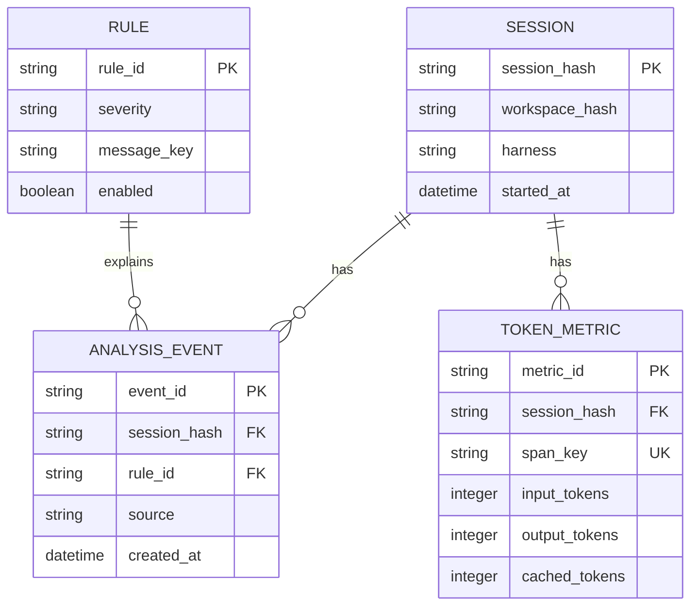

> **Archivierter Stand v0.2.** Speicherimplementierung in v0.3 siehe [storage-architecture-v03.md](storage-architecture-v03.md).

# NAVI — Datenspeicherung, SQLite und Migration

## 1. `.vsix` ist ein Paket, kein Datenträger für Nutzungsdaten

Die `.vsix` wird aus manifestiertem Code und Webview-Assets erstellt. Ihre Inhalte dürfen zur Laufzeit nicht verändert werden. Eine spätere Installation derselben Extension-Version und Upgrades bleiben dadurch reproduzierbar.

**Aktuelle Dateien im Paket:** `extension/package.json`, `extension/src/**`, `extension/media/**`, `extension/README.md`, `extension/LICENSE`. Das Buildscript erzeugt zusätzlich `extension.vsixmanifest` und `[Content_Types].xml`.

**Außerhalb des Pakets:** Settings, Hook-Protokolle, OTel-Protokolle und UI-Historie. VS Code stellt dafür `globalStorageUri`, `globalState`, `workspaceState`, `secrets` und Benutzerkonfiguration bereit.

## 2. Persistenzzustände in v0.2

| Datei | Besitzer | Typ | Lebensdauer | Enthält Originalprompt? |
|---|---|---|---|---|
| `navi-state-v1.json` | NAVI | Snapshot (atomar) | 14 Tage, 150 Einträge | Nein |
| `hook-events.jsonl` | Hook Observer | Append-only / grobe Größenbegrenzung | Bis Reset/Truncate | Nein |
| `copilot-otel.jsonl` | Copilot OTel Exporter | Append-only | Bis Nutzer-Löschung/Exportkonfiguration | Normalerweise nicht, wenn captureContent=false; externe Overrides prüfen |
| `hook-install-*.json` | NAVI | Prüfsummen-/Pfadmanifest | Bis Hook-Uninstall | Nein |
| `globalState` | VS Code | API-State | Bis OTel-Wiederherstellung | Nein |

`workspaceState` wird im MVP bewusst **noch nicht** verwendet. Projektbezogene Analysen auf Basis verschleierter Ordnerkennung sind ein späteres Feature.

## 3. Logical Schema für SQLite (geplant v0.3)

**Physisches SQL:** `docs/schema/sqlite-v1.sql` mit Foreign Keys, `CHECK`-Constraints, Unique Keys, Indizes und `schema_migrations`. Getestet mit SQLite in-memory. SQLite ist **in v0.2 nicht installiert**.

## 4. Migrationspfad

**Migration v0.2 → v0.3 (geplant, idempotent):**

1. Vor der Migration Backup `navi-state-v1.json.bak` anlegen.
2. Neue Datei `globalStorageUri/navi.db.tmp` erstellen.
3. Schema in einer Transaktion installieren, `PRAGMA foreign_keys=ON`, `journal_mode=WAL` nach Dateierstellung.
4. Nur valide Einträge aus JSON-Snapshot importieren; `session_hash` darf `NULL` sein, wenn alte Daten keine Session referenzieren.
5. Nur bekannte Rule-IDs übernehmen; unbekannte Daten protokollieren und überspringen.
6. Transaktion committen, Integritätsprüfung, `.tmp` kontrolliert umbenennen.
7. Snapshot behalten, bis Nutzer die Migration bestätigt oder ein definierter Rollback-Zeitraum abläuft.
8. Nach erfolgreicher Migration neue Speicherung über Repository-Interface (`IEventRepository`) einschalten.

**Rollback:** SQLite-Datei unangetastet lassen, `navi-state-v1.json` wieder als aktive Quelle verwenden. Keine destruktive Rückmigration mit Duplikatimport.

## 5. Datenminimierung

Es werden keine Text-Prompts, Codeblöcke, Dateiinhalte, Tool-Argumente oder Copilot-Transkripte persistiert. Regeln sind whitelisted; die UI speichert nur ID und vorgegebenen Text. Events enthalten pseudonyme, verkürzte Hashes statt Original-Session-IDs. Die Hashes sind keine starke Anonymisierung und müssen trotzdem als potenziell korrelierbar betrachtet werden.

Die OTel-Logdatei stammt von einem **fremden Producer**. Sie kann Repo-Metadaten, Modellnamen und andere Attribute enthalten. Der eigene JSON-Store wird daher nicht mit einer ungefilterten Trace kopiert.

## 6. Retention / Reset

- UI-Snapshot: 14 Tage, maximal 150 Einträge.
- Hook-Protokoll: löschbar über `NAVI: Delete Local Data`; Observer setzt beim Überschreiten von ca. 2 MiB zurück.
- OTel-Protokoll: **keine automatische Rotation durch NAVI**, um den fremden Exporter nicht unkontrolliert zu manipulieren. Der Nutzer sollte die Loggröße kontrollieren; geplante Verbesserung: sichere Rotation nur bei deaktiviertem Export.
- SQLite (geplant): Retention-Job nach Start und bei Tageswechsel, mit konfigurierbarem Zeitfenster.

`NAVI: Delete Local Data` löscht nur NAVI-Laufzeitdateien. Die Hook-Konfigurationsdateien und OTel-Settings werden **nicht** automatisch deaktiviert. Dafür getrennt `Remove Copilot Hooks` und `Disable OpenTelemetry` ausführen. Bereits extern gesicherte Kopien werden nicht von NAVI gelöscht.

## 7. Erweiterungsregeln für Schema-Änderungen

- Jede Schemaänderung erhöht `schema_migrations.version`.
- Keine stillschweigende Speicherung von Prompts im Rahmen einer neuen Funktion.
- Migrationstests mit alten und beschädigten Snapshots.
- Geänderte Metrikdefinitionen als neue Version kennzeichnen, damit historische Zeitreihen vergleichbar bleiben.
- Deduplication-Key aus Trace-/Span-Kennung und Quelle, nicht aus reinem Zeitstempel.
