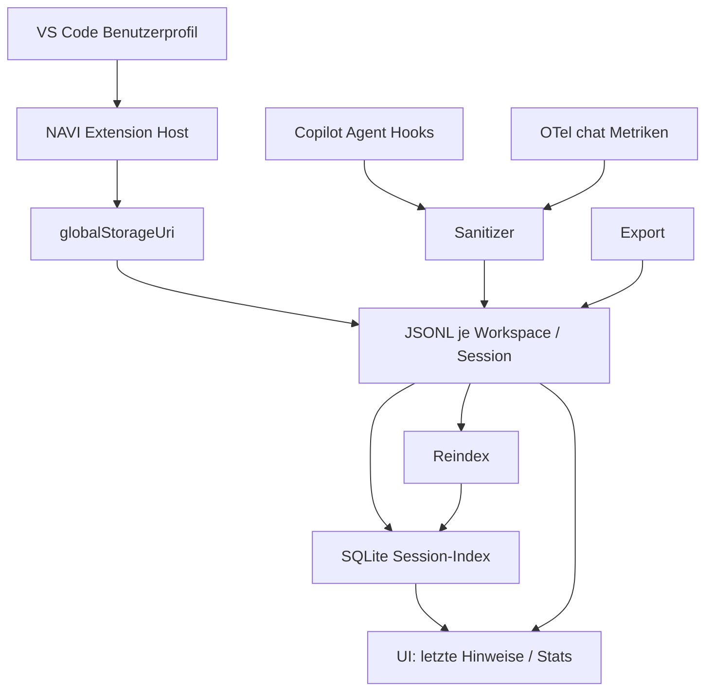
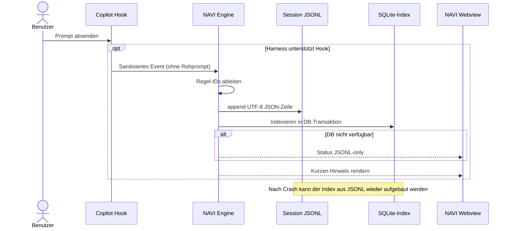

# NAVI v0.3 — Persistenz wie Copilot: Session Journals + SQLite Index

## 1. Verbindliche Entscheidungen

| Entscheidung | Umsetzung |
|---|---|
| Instanz/Identität | Ausführungs- und Speicherbereich von VS Code, keine eigene Anmeldung |
| Physischer Speicher | `context.globalStorageUri.fsPath` für unterstützte lokale Desktop-Hosts |
| Ereignisse pro Session | `<workspace-hash>/<session-hash>.jsonl` (append-only) |
| Index | `navi-index.sqlite` — `node:sqlite`, sofern verfügbar |
| Source of truth | Session-JSONL, niemals der SQLite-Index |
| Keine Projektdatei | Keine Sitzungsdateien im Repository oder `.vscode/` |
| Privatsphäre | Nur standardisierte Rule-IDs und aggregierte Tokenwerte |
| Session-Erkennung | Gehashte Copilot-Hook-Session-ID, sonst `unknown` pro Workspace |
| Aufbewahrung | 30 Tage, bei Start angewendet |
| Synchronisierung | Keine; VS-Code-Settings-Sync synchronisiert keine Session-JSONL |
| Migration | Einmalige Übernahme alter `navi-state-v1.json`-Hinweise aus v0.2 |

## 2. Struktur

## 3. Ablauf eines Ereignisses

## 4. Schema und Datentransparenz

`workspaces(id)` — Hash der VS-Code-Workspace-Kennung. `sessions(id,workspace_id,first_seen,last_seen,events)` — nur anonymisierte Sitzungsmetadaten. `events(id,session_id,at,kind,source,rule_ids)` — Index ohne freie Prompts. `token_metrics(event_id,input_tokens,output_tokens,cached_tokens,calls)` — Aggregate. `schema_migrations(version,applied_at)` — Versionierung.

Die Datenbank nutzt WAL-Mode, Parameter-Bindings und Foreign Keys. Der Index wird beim Start aus den Journaldateien rekonstruiert. Bei fehlendem SQLite-Modul speichert die Extension **weiterhin JSONL** und informiert sichtbar darüber.

## 5. Sicherheit, Grenzen, Betriebsdetails

- Der Hook-Observer schreibt nur `session`-Hash, Wortanzahl, Kategorie, feste Flags und toolCategory in eine Eingangs-JSONL-Datei. NAVI speichert daraus nur erlaubte Daten in seinen Session-Journals.
- NAVI **liest keine fremden Copilot-Chat-Speicherdateien**. Ohne Hook-Erkennung gibt es keine zuverlässige vollständige Copilot-Sitzungszuordnung.
- Die `navi-index.sqlite` ist rekonstruierbar. Falls die Datenbank selbst beschädigt ist und sich nicht öffnen lässt, werden die JSONL-Dateien weiterhin genutzt. Für Reindex muss der beschädigte Index zuerst extern gesichert/entfernt werden.
- Einträge werden zuerst journalisiert, dann indexiert. Ein unerwarteter Absturz zwischen den beiden Schritten kann durch Reindex aufgelöst werden.
- Ein Export kann intern korrelierbare Hash-IDs enthalten. Er soll nicht unbedacht veröffentlicht werden.
- 30-Tage-Retention bezieht sich auf erfolgreich parsebare Session-Ereignisse. Unlesbare Restdaten in beschädigten Journalen benötigen gesonderte Bereinigung.
- JSONL ist die **einzige** vollständig wiederherstellbare Historie; die SQLite-Datei allein dient nicht als Backup.
- Sync, Backup, Datenverschlüsselung und zusätzliche Prozessgrenzen sind nicht automatisch implementiert.

## 6. Testplan

1. Neuinstallation: leerer Benutzer-Storage, kein Datenverlust.
2. Zwei Workspace-IDs: unterschiedliche Verzeichnisse.
3. Mehrere Session-IDs: jeweils eigene Datei.
4. Neustart: Journal und SQLite-Zähler konsistent.
5. SQLite-Datei löschen und neu starten: vollständig neu erzeugt.
6. SQLite nicht verfügbar: JSONL funktioniert, UI zeigt Fallback.
7. Export: nur sanitierte JSON-Daten.
8. Löschen: NAVI-Sitzungsdateien und Index entfernen; andere Dateien nicht anfassen.
9. v0.2-Migration: Hinweis-IDs übernehmen, alte Daten nach erfolgreicher Migration löschen.
10. Echtes VS-Code-/Copilot-Szenario: separat prüfen, noch ausstehend.
